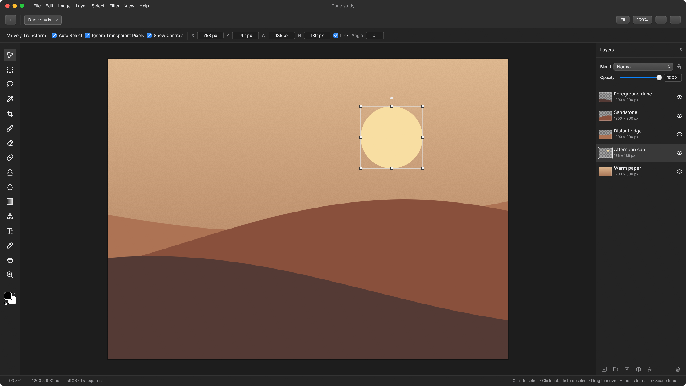

# 小猪修修（原 XUAN）
支持作者：htpps://afdian.com/a/xiaozhuzhugfy
小猪修修（原 XUAN）是一个在 Linux 和 Windows 上运行的原生图层修图、照片修饰和相机 RAW 开发软件。永久免费，无订阅、无广告、无付费入口。

小猪修修源自 XUAN，继续使用同一套 16-bit 图层、蒙版、滤镜和 RAW 工作流；为了兼容旧工程，项目文件仍使用 `.xuan` 扩展名。项目最初受 [Compositor](https://github.com/robbietilton/Compositor) 启发，并以 Rust 重写其核心能力。



## Features

- Compose with layers, groups, masks, blend modes, editable text, and shapes.
- Preserve 16-bit sources through composition, adjustment layers, filters, masks, painting, retouching, and PNG/TIFF export.
- Use standalone mask layers to mask everything below them, limited to their group when grouped. Click the empty area of the Layers panel to deselect, then click Add layer mask; or choose Layer Mask → New Mask Layer.
- Analyze up to eight local faces with 478-point face landmarks, then retouch skin, eyes, teeth, lips and face shape without uploading photos.
- Use manual liquify for face and body shaping, save looks as `.xzp` presets, and apply them to folders with the batch workflow.
- Start from a task-first welcome screen, review one-click portrait templates with a local preview and photo-aware recommendation, then apply the look as one undoable layer.
- Sync one portrait recipe to a folder, assign per-file batch preset overrides, retry only failed files, and compare every exported result against its source before/after.
- Retouch with selections, brushes, clone stamp, healing, filters, and adjustment layers, including non-destructive filter layers for blur, unsharp mask, high pass, posterize, threshold, pixelation, vignette, noise, and lens correction.
- Draw with Wacom, Parblo, and other system-supported tablets on Linux and Windows, with pressure, tilt, and eraser-tip support.
- Smooth mouse and pen strokes with adjustable brush stroke smoothing.
- Develop Nikon NEF/NRW, Canon CR2/CR3/CRW, Fujifilm RAF, and Sony ARW files and return to their RAW settings at any time.
- Open HEIC/HEIF photos directly on Linux and Windows, without installing a converter.
- Save editable `.xuan` projects, import Compositor projects, and export PNG, JPEG, TIFF, or WebP.
- Recover unsaved work after a crash through timed, atomic autosave snapshots.

## Get started

Download a Linux AppImage, `.deb`, `.rpm`, portable archive, or Windows `.zip` from [Releases](https://github.com/yishiyi28/xiaozhu-xiuxiu/releases). Follow the [installation instructions](docs/USAGE.md#install-and-launch), then launch the demo:

```sh
xiaozhu-xiuxiu --demo
```

On Windows, extract the ZIP and launch `xiaozhu-xiuxiu.exe`. Windows uses DirectX 12 or Vulkan; Linux supports Wayland and X11 with working Vulkan drivers. See the [user guide](docs/USAGE.md) for installation, file formats, and editing tools. To build from source, follow the [development guide](docs/DEVELOPMENT.md).

[Keyboard shortcuts](docs/SHORTCUTS.md) · [RAW workflow](docs/RAW.md) · [Project format](docs/FORMAT.md)

## License

A Rust port of [Compositor](https://github.com/robbietilton/Compositor). Source code is [MIT licensed](LICENSE); original Compositor copyright © 2026 Wonder Assembly LLC. Dependency licenses and rebuild instructions are in [third-party notices](THIRD_PARTY.md).
